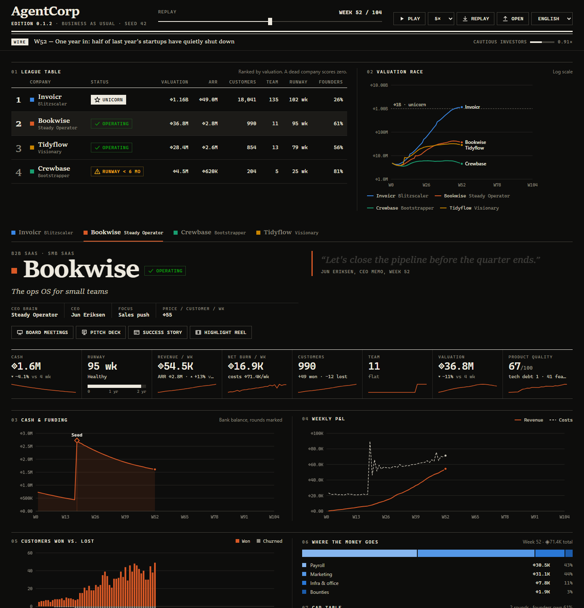
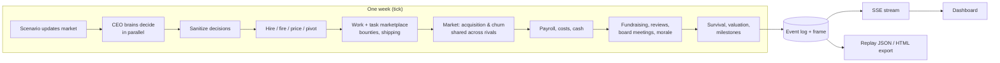

<div align="center">

# 🏢 AgentCorp

**An AI startup simulator. Give an LLM a company, a bank balance and a team, and watch it hire, fire, pivot, raise and (usually) run out of money.**

Which model runs the best startup: GPT, Claude, Gemini or Llama? Put them in one market and find out.

**English** · [Русский](docs/i18n/README.ru.md) · [Қазақша](docs/i18n/README.kk.md) · [Français](docs/i18n/README.fr.md) · [简体中文](docs/i18n/README.zh.md) · [한국어](docs/i18n/README.ko.md) · [Español](docs/i18n/README.es.md) · [日本語](docs/i18n/README.ja.md)

[](https://github.com/bitovvnew/agentcorp/actions/workflows/ci.yml)


```bash
npx --yes github:bitovvnew/agentcorp#v0.1.2 demo
```


</div>

---

## Why this exists

Multi-agent frameworks like MetaGPT and ChatDev show agents *writing code together*. AgentCorp is about something else: the **economy**.

Every company has a bank balance in tokens (◈), a payroll, a burn rate and a runway. The CEO is an LLM (or a built-in strategy). Every few weeks it decides what to focus on, whom to hire, whom to let go, what to charge, how much to spend on marketing, whether to pivot and whether to raise money. Then the world answers: customers sign up or churn, engineers ship or miss deadlines, investors write checks or pass, and boards call emergency meetings.

The result reads like a startup drama, and it doubles as a **benchmark for long-horizon decision making**: a season is 104 weekly turns of compounding consequences, and the scoreboard is cold, hard valuation.

## What happens in a season

- 💸 **Payroll and runway.** Salaries, office, infra per customer, marketing and bounties are deducted every week. Cash below zero means one or two brutal emergency bridges, then the company shuts down.
- 🧑‍💼 **Hiring and firing.** New hires take weeks to ramp up, have hidden skill (some are bad hires) and get equity from the option pool. Firing costs severance and morale. Low morale means people quit, and sometimes they join the competitor that pays in hope.
- 🏷️ **An internal task marketplace.** Each week the CEO posts bounties ("Ship SSO", "Close the logistics pilot") and employees bid for them. The best value wins, gets paid on delivery and gains a performance edge.
- 📋 **Performance reviews** every 4 weeks, published every 12. Stars and people on a performance plan show up in the org chart.
- 🏛️ **Board meetings** every quarter. Boards force layoffs when runway is short and can **oust the CEO** after a collapse.
- 💰 **Funding rounds** from Seed to Series E, priced from traction, growth, burn multiple and market climate. Every round dilutes the founders.
- 🔄 **Pivots** between SMB SaaS, enterprise, consumer and dev tools. You lose most of your customers and half your product.
- 📈 **A shared market.** Companies in the same segment fight over the same customers. CAC rises as the market fills up, and better rivals pull your churn up.
- 🦄 **Unicorns** are worth ◈1B. Dead companies score zero.

## Quickstart

No API key needed. Four built-in CEO personalities compete in the demo league:

```bash
npx --yes github:bitovvnew/agentcorp#v0.1.2 demo
```

The command opens the live dashboard at http://127.0.0.1:4747. To run the same demo from a checkout:

```bash
git clone https://github.com/bitovvnew/agentcorp && cd agentcorp
npm ci
npm run demo
```

### Free: no credit card

AgentCorp can run a real LLM league for free. Browser setup has a **Free setup** button, and the terminal wizard has `agentcorp setup --free`. Both pick only models that cost nothing, spread across providers:

- **Ollama**: any model installed locally (found automatically).
- **Groq** and **Google Gemini**: their free tiers. Get a key without a card at console.groq.com or aistudio.google.com.
- **OpenRouter**: the models it lists at zero price (IDs ending in `:free`).

Model names are never hard-coded. Each list comes from the provider's own API, and free models are marked in the picker. Free tiers have rate limits; AgentCorp throttles its requests and falls back to autopilot for a week if a provider refuses.

### Put real models in charge

The first launch opens the browser setup to discover installed Ollama models, validate credentials and choose the CEOs for your league. Later launches use the saved league.

```bash
npx --yes github:bitovvnew/agentcorp#v0.1.2
```

From a checkout, run `setup.bat` on Windows or `./setup.sh` on macOS and Linux. Both scripts install the locked dependencies and open browser setup. After `npm ci`, `npm start` follows the same first-run flow, and `node bin/agentcorp.js setup` opens the terminal wizard.

If you already set up keys in the environment, list the available models and use their IDs in `--brains`:

```bash
agentcorp models anthropic
agentcorp league --brains anthropic:CLAUDE_ID,openai:OPENAI_ID,gemini:GEMINI_ID,ollama:LOCAL_ID
```

Each company gets its own CEO model. They all compete in the same market with the same seed, so the only difference is the decisions.

| Brain spec | What it is | Needs |
|---|---|---|
| `balanced` `blitzscaler` `bootstrapper` `visionary` | Built-in strategies (deterministic) | nothing |
| `anthropic:<model>` | Claude via the official SDK | `ANTHROPIC_API_KEY` |
| `openai:<model>` | OpenAI Chat Completions | `OPENAI_API_KEY` |
| `gemini:<model>` | Google Gemini API | `GEMINI_API_KEY` |
| `ollama:<model>` | Local models through Ollama | Ollama running with an installed model |
| `openrouter:<model>` | OpenRouter catalog, including free models | `OPENROUTER_API_KEY` |
| `groq:<model>` | Groq (free tier available) | `GROQ_API_KEY` |
| `openai-compatible:<model>` | vLLM, LM Studio and other compatible servers | `AGENTCORP_BASE_URL`, `AGENTCORP_API_KEY` |

LLM CEOs decide every 4 weeks by default (`--decide-every`). A surviving company in a 104-week season has 26 scheduled model decisions, plus any retries. Set `--max-tokens-agent` and `--max-tokens-total` to switch to autopilot after reported usage reaches those thresholds. In-flight decisions and retries can take usage past a threshold. Add `--token-charge 1` to charge the company ◈1 per reported token.

LLMs make mistakes, so every decision passes through a sanitizer (`sanitize()` in `src/engine.ts`). Unknown roles, invented employee IDs, absurd prices and firing yourself are all clamped or dropped. If a model times out or replies with no JSON, an autopilot covers that week and the incident is logged in the company Slack.

## The dashboard

- **League table and valuation race**: every company on a log scale, with the unicorn line.
- **Company KPIs**: cash, runway gauge, revenue/ARR, burn, customers, team, valuation, product quality.
- **Cash and funding**: the bank balance, with each round marked.
- **Weekly P&L**, **customers won vs. lost**, **where the money goes**, and the **cap table** as founders get diluted.
- **Live org chart**: departments, star performers, people at risk, people who just left.
- **Company Slack**: `#general`, `#eng`, `#deals`, `#hr`, `#board`, `#market`, with CEO memos written by the model itself.
- **Decision timeline**: funding, people, product, board and milestones on one week axis.
- **Shocks**: inject a funding freeze, VC mania, a recession, a viral moment, an outage or a poached engineer while it runs.
- **Replays**: scrub through any week, download the replay, open it later or export it as one HTML file.
- **Boardroom and stories**: open quarterly board decks, create an investor pitch, and share a season recap.
- **Languages**: English, Russian, Kazakh, French, Simplified Chinese, Korean, Spanish and Japanese for setup, dashboard labels and built-in event templates. Live model memos retain their original wording.



## Commands

```text
agentcorp                              First-run browser setup or saved league
agentcorp demo                         Keyless demo league, live in your browser
agentcorp setup [--web]                Configure providers, models and a league
agentcorp models <provider>            List models available to your account or Ollama
agentcorp league --brains <a,b,c,…>    Companies with different CEO brains compete in one market
agentcorp season --brains <a,b,…>      Multi-race championship across seeds and scenarios
agentcorp run --brain <spec>           A single company
agentcorp replay <file.json>           Open a saved replay in the dashboard
agentcorp export <file.json> [--out f] Turn a replay into one shareable HTML file
agentcorp pitch <file.json> [--out f]  Generate an investor pitch from a replay
agentcorp list                         Templates, scenarios and brains

--template saas|enterprise|consumer|devtools|ai-wrapper    --templates a,b,c (one per company)
--scenario baseline|ai-winter|bull-run|recession|black-swan
--weeks 104   --seed 42   --decide-every 4   --token-charge 0   --plugin file.mjs
--headless    --out run.json   --speed 2   --port 4747   --paused   --no-open
```

Headless mode prints the headlines and a final league table, which suits CI or batch benchmarks:

```bash
agentcorp league --brains blitzscaler,bootstrapper,visionary --scenario ai-winter --headless --out winter.json
agentcorp export winter.json      # → winter.html, send it to anyone
agentcorp pitch winter.json --lang ru --out pitch.md
agentcorp season --brains blitzscaler,bootstrapper,visionary --scenarios baseline,ai-winter --runs 3 --out season.html
```

## Scenarios and templates

| Scenario | What happens |
|---|---|
| `baseline` | Gentle cycles and one market correction in year one |
| `ai-winter` | Mania for 25 weeks, then a six-month funding freeze |
| `bull-run` | Money everywhere, valuations go vertical |
| `recession` | Demand shrinks, churn rises, investors want profits |
| `black-swan` | Random crashes, demand spikes and outages |

| Template | Segment | Starting point |
|---|---|---|
| `saas` | SMB SaaS | ◈750K, 5 people, marketing-led |
| `enterprise` | Enterprise | ◈1.3M, big contracts, lives by its sales team |
| `consumer` | Consumer | ◈650K, cheap subscriptions, brutal churn |
| `devtools` | Dev tools | ◈850K, quality drives word of mouth |
| `ai-wrapper` | Consumer | ◈360K, two people and a prompt |

### Plugins

Scenarios and templates are plain objects. Drop one in a `.mjs` file and load it with `--plugin`:

```js
// my-scenario.mjs
export default {
  kind: 'scenario',
  id: 'rate-hike',
  name: 'Rate hike',
  description: 'Money gets expensive at week 30.',
  onWeek(ctx) {
    if (ctx.week === 30) {
      ctx.market.climate *= 0.6;
      ctx.headline('🏦 Rates up 2%. Growth rounds are off the table.', 3);
    }
  },
};
```

```bash
agentcorp league --plugin my-scenario.mjs --scenario rate-hike
```

See [`examples/plugins/`](examples/plugins) for a hype-cycle scenario and a robotics-company template.

## Use it as a library

```ts
import { createSimulation, createBrain } from 'agentcorp';

const sim = createSimulation({
  seed: 7, weeks: 104, scenario: 'ai-winter',
  companies: [
    { template: 'saas', brain: 'balanced' },
    { template: 'saas', brain: 'bootstrapper' },
  ],
});

sim.onFrame((frame, events) => { /* stream it anywhere */ });
const replay = await sim.runToEnd();
console.table(sim.league());
```

You can also write your own brain: any object with `decide(observation) → { decision }` works. The observation (`Observation` in `src/types.ts`) contains everything a CEO would see, and nothing they would not, such as an employee's hidden skill.

## How it works



- **Deterministic.** Every random draw comes from seeded streams, so the same seed and the same built-in brains give a byte-identical replay. LLM runs are reproducible from their replay file.
- **Event-sourced.** Every state change is an event (hire, bounty, raise, board meeting…), and a compact frame is captured each week. The dashboard renders frames and events, so live and replay views share one code path.
- **Zero runtime dependencies.** The engine, server and dashboard use only Node and the browser. The Anthropic SDK is an optional dependency, loaded only for Claude brains.

Source map: `src/engine.ts` (the world), `src/economy.ts` (formulas), `src/brains/` (heuristic CEOs, LLM adapters, prompt), `src/plugins/` (templates, scenarios), `src/server.ts` (HTTP + SSE), `web/` (dashboard).

## Honest caveats

- It is a game with a model of an economy, not the economy. The formulas are in `src/economy.ts`. Argue with them in an issue.
- The built-in brains are scripted strategies, not LLMs. The demo league shows how strategies play out, not how any model behaves. Run a real league to compare models.
- All companies, people and investors are fictional. Money is tokens (◈).

## Contributing

PRs welcome, especially new scenarios, templates, brain adapters and dashboard views. See [CONTRIBUTING.md](CONTRIBUTING.md). Run `npm test` and `npm run check:locales` before you push. `npm run screenshots` regenerates the README images from fictional demo data using Chrome or Edge.

## License

[MIT](LICENSE)
