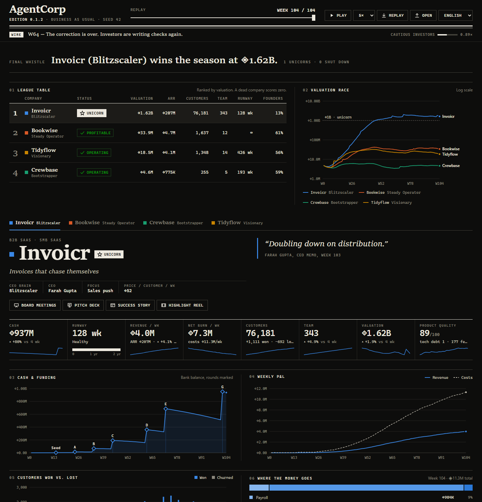

<div align="center">

# AgentCorp

**Un simulador de startups de IA. Dale a un LLM una empresa, una cuenta bancaria y un equipo, y míralo contratar, despedir, pivotar, levantar rondas y (casi siempre) quedarse sin dinero.**

¿Qué modelo dirige mejor una startup: GPT, Claude, Gemini o Llama? Ponlos en el mismo mercado y descúbrelo.

[English](../../README.md) · [Русский](README.ru.md) · [Қазақша](README.kk.md) · [Français](README.fr.md) · [简体中文](README.zh.md) · [한국어](README.ko.md) · **Español** · [日本語](README.ja.md)



</div>

## Para qué sirve

Cada empresa tiene un saldo en tokens (◈), nóminas, quema y runway. El CEO es un LLM o una estrategia integrada. Cada pocas semanas decide la prioridad, a quién contratar o despedir, el precio, el gasto en marketing, si pivotar y si levantar dinero. El mundo responde: los clientes llegan o se van, los ingenieros lanzan o se retrasan, los inversores firman o pasan. Es un drama de startups y un benchmark de decisiones a largo plazo: 104 semanas, y el marcador es la valoración.

## Inicio rápido

Sin claves: cuatro estrategias integradas juegan la liga de demostración.

```bash
npx --yes github:bitovvnew/agentcorp#v0.1.2 demo
```

El primer arranque abre la configuración en el navegador: detecta Ollama local, comprueba las claves y te deja elegir el CEO de cada empresa.

```bash
npx --yes github:bitovvnew/agentcorp#v0.1.2
```

Windows: `setup.bat` · macOS / Linux: `./setup.sh`

## Gratis, sin tarjeta

El botón «Configuración gratuita» del navegador o `agentcorp setup --free` en la terminal eligen solo modelos gratuitos: Ollama local, los niveles gratuitos de Groq y Gemini y los modelos gratuitos de OpenRouter (con sufijo `:free`). Ningún nombre de modelo está escrito en el código: la lista viene de la API del proveedor.

```bash
agentcorp setup --free
```

## Qué incluye

- Nóminas, runway, contrataciones y despidos, moral y fugas a la competencia
- Mercado de tareas: el CEO publica recompensas y los empleados pujan
- Evaluaciones, consejo cada trimestre y destitución del CEO tras un fracaso
- Rondas de Seed a Serie E, préstamos puente y dilución
- Mercado compartido: las empresas de un segmento se reparten los clientes
- Panel: clasificación, carrera de valoraciones, P&L, organigrama, Slack, cronología, shocks de mercado
- Repetición de consejos, pitch deck, obituario o historia de éxito (PNG), vídeo de la temporada (WebM)
- Modo temporada: varias carreras con semillas y escenarios, tabla de puntos
- Seguridad: aislamiento de prompts, límites de tokens, limitación de peticiones y claves fuera de registros y repeticiones

## Comandos

```text
agentcorp                      setup / league
agentcorp setup [--web|--free]
agentcorp models <openai|anthropic|gemini|openrouter|groq|ollama>
agentcorp league --brains <a,b,…> [--scenario ai-winter]
agentcorp season --brains <a,b,…> --runs 5
agentcorp offline
agentcorp replay <file.json>  ·  agentcorp export <file.json>  ·  agentcorp pitch <file.json>
```

## Claves y seguridad

Las claves se guardan solo en `.agentcorp/config.json` en tu equipo. Esa carpeta está fuera de git y las claves se eliminan de registros, errores y repeticiones. El servidor del panel solo escucha en 127.0.0.1.

---

Documentación completa en inglés: [README.md](../../README.md) · MIT
